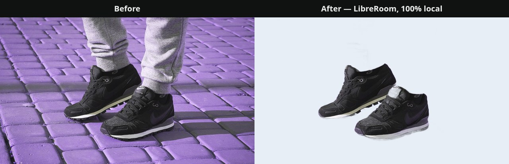
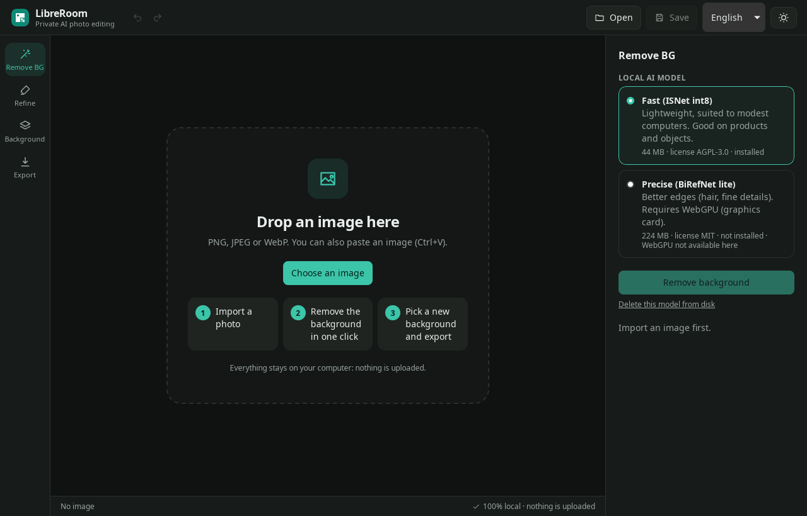
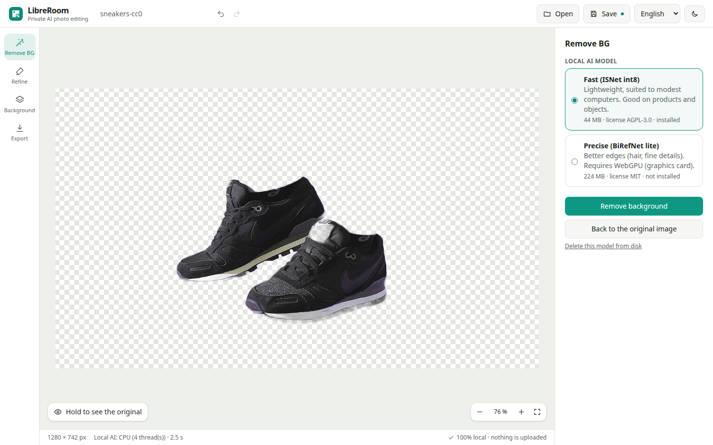
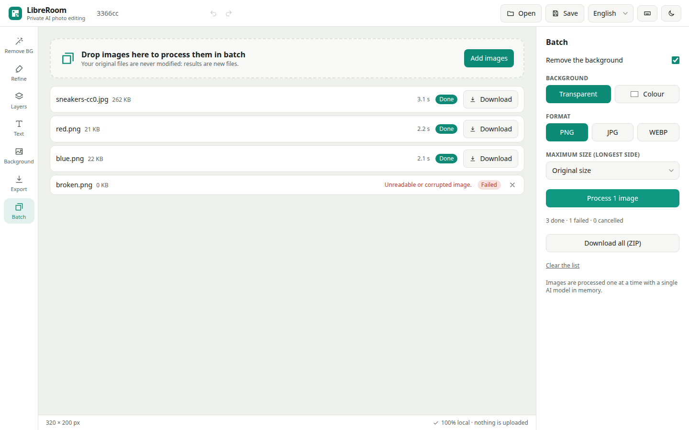
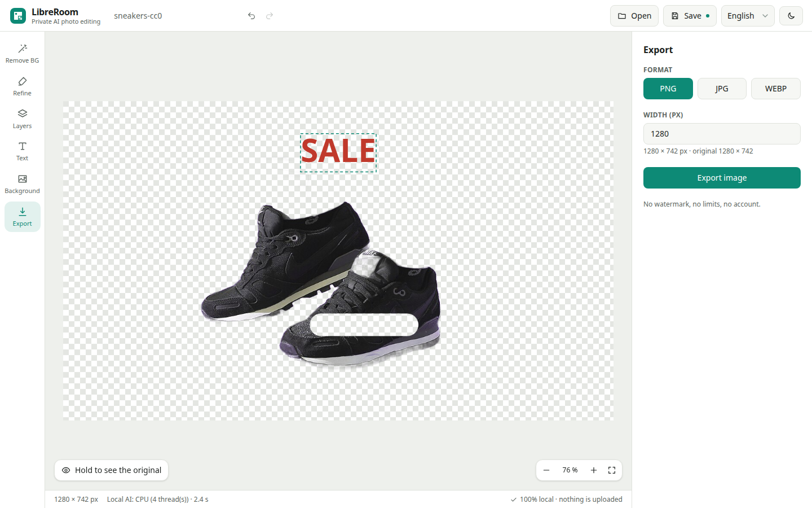

<div align="center">


# LibreRoom

**Remove backgrounds. Keep your photos to yourself.**

A free and open-source photo editor that removes backgrounds with AI **running entirely on your computer**.<br>
No account. No upload. No watermark. No subscription.

[](LICENSE)
[](#installation)
[](CONTRIBUTING.md)



<sub>Real output of LibreRoom 0.1 (Fast model, no manual touch-up), generated by <code>scripts/make-readme-visuals.mjs</code>.</sub>

</div>

---

## Why LibreRoom?

Online background removers are convenient, but your photos go to someone else's server. Free plans also tend to come with a watermark, a quota or an account. LibreRoom takes the opposite approach:

- 🔒 **Private by design**: images are processed locally and never leave your machine. There is no telemetry, no analytics and no tracker. The automated tests fail if the app contacts any server other than the one you download the model from.
- ✈️ **Works offline**: download the AI model once (44 MB, integrity-checked) and you're done.
- 🆓 **Free, for real**: no paid tier, no export limits, no watermark, ever. Licensed AGPL-3.0, so it stays that way.
- 🪶 **Light and fast**: the desktop app starts in under half a second, idles around 160–250 MB of RAM, and removes a background in about 1.3 s with native AI ([measured](docs/performance.md)).
- 🧑‍🎨 **Simple**: three steps: import, remove the background, export. Built for people who have never used a photo editor.

## Features

Available in **0.1** (tested automatically):

| | |
|---|---|
| ✂️ **AI background removal** | Local model (ISNet): native ONNX Runtime on desktop (~1.3 s per photo on a laptop CPU), WebAssembly/WebGPU in the browser |
| 🖌️ **Refine brush** | Erase leftovers or restore parts of the subject; hold-to-compare with the original |
| 🧱 **Layers** | Stack images and texts; drag, resize and rotate them with handles; smart guides and alignment; multiple selection |
| 🌑 **Shadows** | Soft drop shadows that follow the cut-out or the letters |
| 🗂️ **Batch processing** | Remove the background of many photos in one go, with progress, cancel and ZIP download |
| 🔤 **Text** | Multi-line text with font family, size, bold/italic, colour and alignment |
| 🎨 **New background** | Transparent, any colour, or your own image |
| 📤 **Export** | PNG (transparent), JPG or WebP at any width; tested up to 48 megapixels |
| ↩️ **Undo / redo** | Ctrl+Z / Ctrl+Shift+Z |
| 💾 **Projects and autosave** | `.libreroom` files (all layers); crash recovery restores unsaved work |
| 🌗 **Light and dark themes** | English and French interface |
| 🖥️ **Desktop and web** | Native Linux app (Tauri 2), or any Chromium-based browser |

On the [roadmap](CHANGELOG.md#roadmap): canvas resizing, colour adjustments, object removal with local AI and upscaling.

## Screenshots

<table>
<tr>
<td width="50%"><br><sub>Desktop app (Linux, dark theme)</sub></td>
<td width="50%"><br><sub>Background removed (web version)</sub></td>
</tr>
<tr>
<td><br><sub>Batch processing</sub></td>
<td><br><sub>Layers and text</sub></td>
</tr>
</table>

All screenshots are unedited captures of the running app.

## Installation

> LibreRoom is in early development. No binary release has been published yet, so for now you build it from source.

### Linux (desktop)

Tested on Ubuntu 26.04 (x86_64).

```bash
# 1. System dependencies (Debian/Ubuntu)
sudo apt-get install libwebkit2gtk-4.1-dev libxdo-dev libssl-dev libayatana-appindicator3-dev librsvg2-dev pkg-config build-essential
# 2. Rust: https://rustup.rs, then Node.js 22+
# 3. Build
git clone https://github.com/nahilwl/LibreRoom.git && cd LibreRoom
npm install
npm run tauri build    # packages in src-tauri/target/release/bundle/
```

### Web

```bash
npm install
npm run build && npm run preview   # open http://localhost:4173
```

A hosted version on GitHub Pages is planned ([details](docs/web-deployment.md)).

### Windows and macOS

Not available yet. The project is configured for both (Tauri 2 targets, icons), but neither has been built or tested. [Help is welcome](CONTRIBUTING.md)!

## Privacy and offline use

| | |
|---|---|
| Images | Processed in memory on your device. Never uploaded. |
| Network | Only when *you* click **Download the model** (Hugging Face, pinned version, SHA-256 verified). The desktop app opens no network port. |
| Accounts, ads, telemetry | None. |
| Offline | Fully functional once a model is installed (tested with all remote connections blocked). |
| Storage | Models in the app's local cache; autosave in local IndexedDB; your projects wherever you save them. |

## Documentation

| | |
|---|---|
| 📘 [User guide](docs/user-guide.md) | How to use LibreRoom, shortcuts |
| 🛠️ [Developer guide](docs/developer-guide.md) | Build, test, conventions |
| 🏗️ [Architecture](docs/architecture.md) | How it works and why |
| 🤖 [AI models](docs/ai-models.md) | Models, licenses, provenance |
| ⚡ [Performance](docs/performance.md) | Measured speed and memory |
| ❓ [FAQ](docs/faq.md) | Common questions |
| 🐞 [Known issues](docs/known-issues.md) | Current limitations |
| 🎨 [Brand](docs/brand.md) | Logo, colours, typography |
| 🔍 [Research](docs/research/overview.md) | Study of comparable products' public behaviour |

## Contributing

Contributions of all kinds are welcome: code, testing on Windows or macOS, translations, design and documentation.

- Read [CONTRIBUTING.md](CONTRIBUTING.md) to get started.
- 🐞 Found a bug? [Open a bug report](../../issues/new?template=bug_report.yml).
- 💡 Have an idea? [Suggest a feature](../../issues/new?template=feature_request.yml).
- 🔐 Security issue? See [SECURITY.md](SECURITY.md) (please don't open a public issue).

## License

LibreRoom is free software under the [GNU Affero General Public License v3.0 or later](LICENSE).

## Acknowledgements

- [ISNet / DIS](https://github.com/xuebinqin/DIS) by Xuebin Qin et al., and the [ONNX export](https://huggingface.co/onnx-community/ISNet-ONNX) by onnx-community
- [BiRefNet](https://github.com/ZhengPeng7/BiRefNet) by Peng Zheng et al.
- [ONNX Runtime](https://onnxruntime.ai), [Tauri](https://tauri.app), [React](https://react.dev), [Vite](https://vite.dev), [Tailwind CSS](https://tailwindcss.com)
- Test photo: [*Sneakers and sweatpants on purple background*](https://commons.wikimedia.org/wiki/File:Sneakers_and_sweatpants_on_purple_background.jpg), CC0, Wikimedia Commons

LibreRoom is an independent project and is not affiliated with any commercial photo-editing service.
